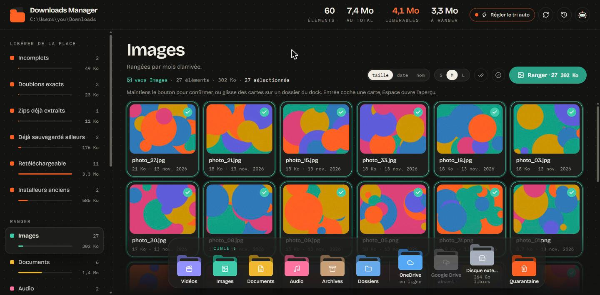
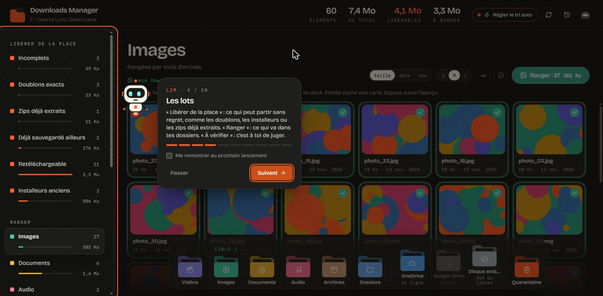

<p align="center">
  
</p>

<h1 align="center">Downloads Manager</h1>

<p align="center">
  <b>Fais le tri dans ton dossier Téléchargements en quelques minutes. Rien n'est supprimé sans 30 jours pour changer d'avis.</b>
</p>

<p align="center">
  <a href="README.md">Read in English</a>
</p>



Le dossier Téléchargements se remplit d'installeurs lancés une fois, de zips déjà extraits, du même fichier téléchargé trois fois et de gros exports qu'on pourrait récupérer à nouveau. Downloads Manager le scanne, range tout par lots et permet de vider chaque lot d'un geste, sans risque.

## Fonctions

- **Des lots intelligents** : doublons exacts (octet par octet), zips déjà extraits à côté, vieux installeurs, fichiers déjà présents dans tes sauvegardes, téléchargements incomplets, et gros fichiers retéléchargeables (torrents, exports Google Drive, liens publics).
- **Rangement par type** : vidéos, images, documents, audio et archives partent dans tes dossiers habituels, classés par date. Glisse des cartes sur un dossier du dock, ou maintiens un bouton pour confirmer tout un lot.
- **Rien n'est supprimé tout de suite** : tout passe 30 jours en quarantaine. Tu peux remettre un fichier ou un lot entier à tout moment, depuis l'appli. Un reçu CSV garde le nom, la taille et le lien d'origine de tout ce qui part.
- **Chaque action s'annule** depuis l'historique, même plusieurs jours après.
- **Tri automatique, en option** : éteint par défaut. Une fois activé, il ne touche qu'aux fichiers qui arrivent ensuite, attend le délai choisi (1 à 30 jours), ne touche jamais aux dossiers ni aux noms sensibles (factures, contrats…), et montre ce qui attend son tour.
- **Miniatures natives** de l'Explorateur Windows, aperçu rapide avec la barre d'espace, utilisable au clavier.
- **Lim**, un petit robot guide, fait le tour de l'appli au premier lancement.
- **Français et anglais** : l'appli suit la langue de Windows ; `"language": "fr"` ou `"en"` dans `config.json` pour en forcer une.
- **Tout reste sur ton PC** : sa propre fenêtre, une icône près de l'horloge, des notifications Windows. Pas de compte, pas de cloud, aucune donnée envoyée : le serveur local ne répond que sur `127.0.0.1`.



## Installation

1. Télécharge `Downloads-Manager.zip` depuis la [dernière version](../../releases/latest) et dézippe-le.
2. Lance `Downloads Manager.exe`. L'exe n'est pas encore signé : Windows peut afficher « Windows a protégé votre ordinateur ». Clique sur **Informations complémentaires**, puis **Exécuter quand même**.
3. Clique sur **Scanner**.

Au premier lancement, l'appli ajoute un raccourci dans le menu Démarrer et se lance avec Windows (juste l'icône près de l'horloge). Ça se désactive depuis le menu de l'icône (clic droit). Fermer la fenêtre garde l'appli près de l'horloge ; **Quitter** dans ce menu l'arrête.

Prérequis : Windows 10 ou 11 avec WebView2 (déjà présent sur Windows 11 et sur Windows 10 à jour). Sans WebView2, l'appli s'ouvre dans le navigateur par défaut.

## Depuis les sources

```bat
git clone https://github.com/GaryDeeplo/downloads-manager
cd downloads-manager
py -3.12 -m venv .venv
.venv\Scripts\python -m pip install -r requirements.txt
start.bat
```

L'interface compilée est dans `dm/static` : Node n'est utile que pour modifier le front (`cd web && npm ci && npm run dev`). Pour l'exe : `cd web && npm run build`, puis `.venv\Scripts\python tools\build_exe.py`.

Démo sans toucher aux vrais fichiers : `python tools\make_demo.py`, puis `set DM_CONFIG=%TEMP%\dm-demo\config.json` avant `python -m dm`. Tests : `.venv\Scripts\python -m pytest`.

Réglages (dossiers cibles, délais, mots sensibles) : un `config.json` à côté de l'exe. Toutes les clés sont dans `dm/config.py`.

## Licence

[MIT](LICENSE)
