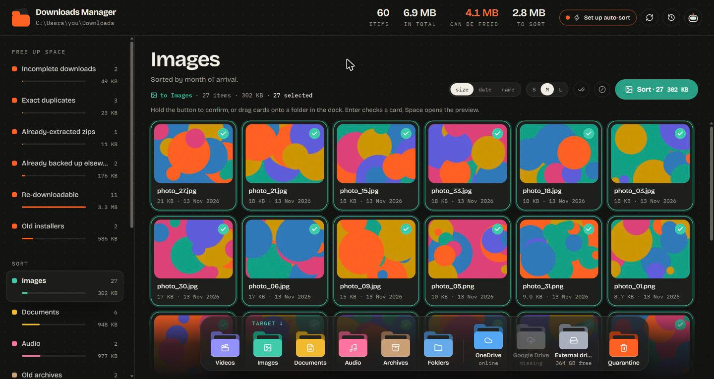
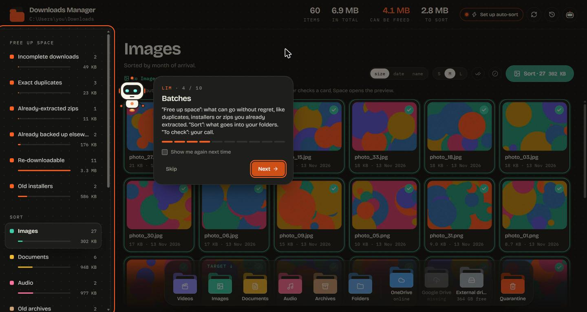

<p align="center">
  
</p>

<h1 align="center">Downloads Manager</h1>

<p align="center">
  <b>Clean up your Windows Downloads folder in minutes. Nothing is ever deleted without a 30-day undo.</b>
</p>

<p align="center">
  <a href="../../releases/latest"></a>
  
  <a href="LICENSE"></a>
</p>

<p align="center">
  <a href="README.fr.md">Lire en français</a>
</p>



Your Downloads folder fills up with installers you ran once, zips you already extracted, the same file downloaded three times and huge exports you could grab again. Downloads Manager scans it, sorts everything into batches and lets you clear each batch with one gesture, safely.

## Features

- **Smart batches.** Exact duplicates (byte for byte), zips already extracted next to them, old installers, files already present in your backups, partial downloads, and large files you can download again (torrents, Google Drive exports, public links).
- **Sort by type.** Videos, images, documents, audio and archives go to your usual folders, organized by date. Drag cards onto a folder of the dock, or hold a button to confirm a whole batch.
- **Nothing is deleted right away.** Everything goes to a quarantine for 30 days. Restore one file or a whole batch at any time, from inside the app. A CSV receipt keeps the name, size and source link of everything that leaves.
- **Every action can be undone** from the history, even days later.
- **Optional auto-sort.** Off by default. When you turn it on, it only touches files that arrive afterwards, waits the delay you choose (1 to 30 days), never touches folders or sensitive names (invoices, contracts…), and shows you what is waiting and when.
- **Native thumbnails** from Windows Explorer, quick preview with the space bar, keyboard support.
- **Lim**, a small robot guide, walks you through the app on first launch.
- **English and French.** The app follows your Windows language; switch any time with the FR / EN button in the header.
- **Runs locally.** Its own window, an icon next to the clock, Windows notifications. No account, no cloud, no telemetry: the local server only answers on `127.0.0.1`.



## Download

1. Download `Downloads-Manager.zip` from the [latest release](../../releases/latest) and unzip it.
2. Run `Downloads Manager.exe`. The exe is not code-signed yet, so Windows SmartScreen may warn you: click **More info**, then **Run anyway**.
3. Click **Scan**.

On first launch the app adds a Start menu shortcut and starts with Windows (icon only, next to the clock). You can turn that off from the icon's right-click menu. Closing the window keeps the app next to the clock; use **Quit** in that menu to stop it.

Requirements: Windows 10 or 11 with the WebView2 runtime (preinstalled on Windows 11 and on up-to-date Windows 10). Without WebView2, the app opens in your default browser instead.

## How it works

| Part | What it does |
|---|---|
| Scanner and rules (`dm/`) | Indexes the Downloads folder, detects duplicates (size, then hash), extracted zips, backups and download sources, and builds the batches |
| Journal (`dm/actions.py`) | Every move goes through a SQLite journal, so each batch can be undone; quarantine lives in `%LOCALAPPDATA%\DownloadsManager` |
| Local API (`dm/server.py`) | FastAPI on `127.0.0.1:8765`, only reachable from the app itself (foreign hosts, origins and requests without the app header are refused) |
| Interface (`web/`) | React, TypeScript, Vite, Tailwind CSS and Motion, built into `dm/static` |
| Window (`dm/window.py`) | pywebview on WebView2, tray icon with pystray, notifications with windows-toasts |

Settings (target folders, delays, sensitive words) can be overridden in a `config.json` next to the exe. See `dm/config.py` for every key.

## Build from source

```bat
git clone https://github.com/GaryDeeplo/downloads-manager
cd downloads-manager
py -3.12 -m venv .venv
.venv\Scripts\python -m pip install -r requirements.txt
start.bat
```

The compiled interface is committed in `dm/static`, so Node is only needed to change the front end (`cd web && npm ci && npm run dev`). To build the exe: `cd web && npm run build`, then `.venv\Scripts\python tools\build_exe.py`.

Try it without touching your real files: `python tools\make_demo.py`, then `set DM_CONFIG=%TEMP%\dm-demo\config.json` before `python -m dm`.

## Contributing

Bug reports, ideas and pull requests are welcome. See [CONTRIBUTING.md](CONTRIBUTING.md). To report a security issue, see [SECURITY.md](SECURITY.md).

## License

[MIT](LICENSE)
